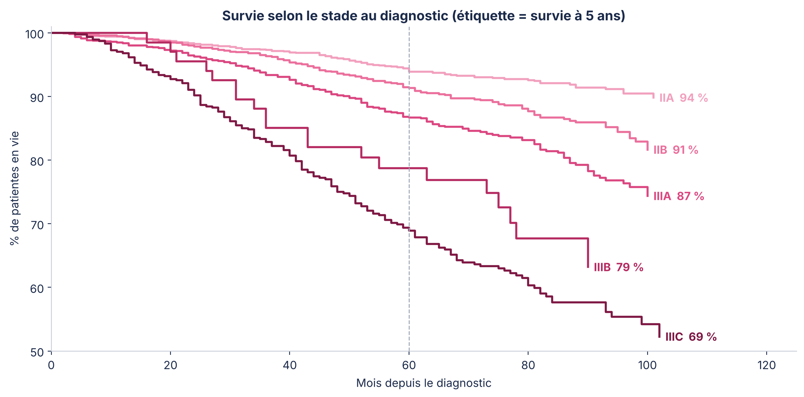
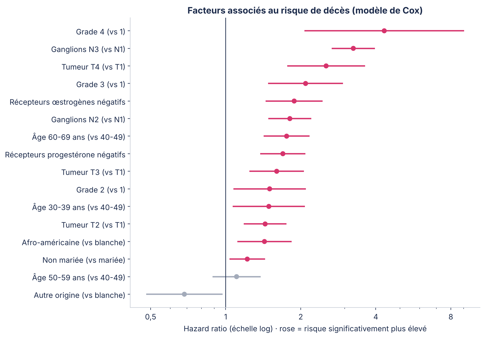
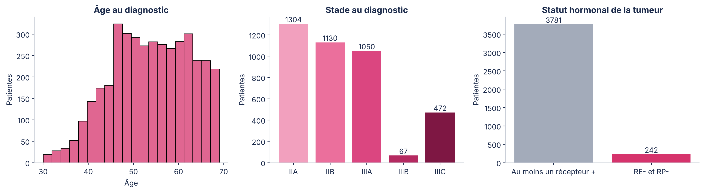
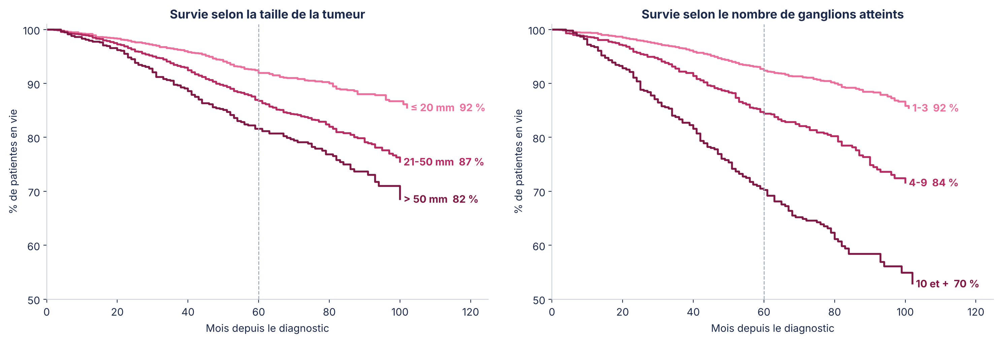
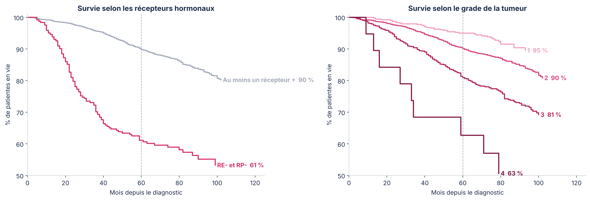
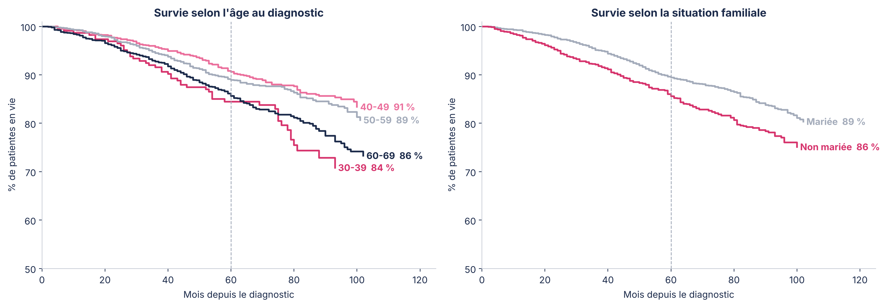

# Octobre Rose · Diagnostic précoce et survie au cancer du sein


Cas d'étude data réalisé à l'occasion d'**Octobre Rose** : une ONG (fictive) de lutte contre le cancer du sein veut savoir où concentrer ses moyens pour sa campagne. L'analyse porte sur la survie de **4 023 patientes** et répond à trois questions :

1. **Combien le moment du diagnostic pèse-t-il sur la survie ?** (stade, taille de la tumeur, ganglions atteints)
2. **Quels profils de patientes ont le pronostic le plus défavorable ?** (biologie de la tumeur, âge, situation familiale)
3. **Quels messages et quelles cibles prioriser ?**

---

## Résultats clés

| Indicateur | Résultat |
|---|---|
| Patientes analysées | 4 023 (616 décès, 15,3 %) · suivi médian 73 mois |
| Survie globale à 5 ans | **88,1 %** |
| Survie à 5 ans, stade IIA → IIIC | **93,9 % → 68,9 %** |
| Survie à 5 ans selon les ganglions atteints | 92,4 % (1-3) · 84,4 % (4-9) · **70,2 % (10 et +)** |
| Survie à 5 ans selon la taille de la tumeur | 91,9 % (≤ 20 mm) · 86,8 % (21-50 mm) · 81,6 % (> 50 mm) |
| Tumeurs sans récepteurs hormonaux (RE- et RP-) | **61,1 %** de survie à 5 ans, contre 89,8 % |
| Modèle de Cox · C-index | **0,74** |

**Le stade au diagnostic est le premier déterminant de la survie** : diagnostiquer plus tôt, c'est faire passer la survie à 5 ans de 69 % à 94 %.



À caractéristiques égales (modèle de Cox), les facteurs qui pèsent le plus sur le risque de décès sont :

- l'atteinte ganglionnaire étendue : **HR 3,25** pour N3 (vs N1) ;
- une tumeur T4 : **HR 2,53** (vs T1) ;
- un grade élevé : **HR 2,09** pour le grade 3 et **4,33** pour le grade 4 (vs 1, effectif faible : 19 patientes) ;
- l'absence de récepteurs aux œstrogènes : **HR 1,88**, et à la progestérone : **HR 1,70** ;
- l'âge : **HR 1,49** entre 30 et 39 ans et **1,76** entre 60 et 69 ans (vs 40-49 ans) ;
- le fait de ne pas être mariée : **HR 1,22**.



---

## Recommandations pour l'ONG

| Constat | Action |
|---|---|
| Le stade au diagnostic détermine la survie | Faire du **diagnostic précoce** le message central : autopalpation, examen clinique, mammographie |
| L'atteinte ganglionnaire est le facteur le plus lourd | Suivre la **part de diagnostics précoces** comme indicateur d'impact de la campagne |
| Les tumeurs sans récepteurs hormonaux sont plus graves | **Plaidoyer** pour l'accès aux tests des récepteurs et aux traitements adaptés |
| Les moins de 40 ans et les 60-69 ans sont plus exposées | **Cibler** aussi les jeunes femmes, souvent hors des campagnes de dépistage |
| L'isolement social pèse sur le pronostic | **Accompagner** : pair-aidance, transport, suivi du parcours de soins |

---

## Méthode

1. **Nettoyage et contrôles qualité** : valeurs manquantes, doublons (1 ligne retirée), cohérence taille / stade T (7 incohérences signalées).
2. **Analyse descriptive** : profil des patientes et mortalité brute par facteur.
3. **Courbes de survie de Kaplan-Meier** et **tests du log-rank** par stade, taille, ganglions, récepteurs hormonaux, grade, âge et situation familiale.
4. **Modèle de Cox à risques proportionnels** pour mesurer l'effet propre de chaque facteur (hazard ratios, IC 95 %), évalué par l'**indice de concordance de Harrell**.
5. **Traduction en recommandations** opérationnelles pour l'ONG.

Outils : `pandas`, `numpy`, `matplotlib`, `seaborn`, `statsmodels` (`SurvfuncRight`, `survdiff`, `PHReg`).

<details>
<summary>Autres figures</summary>






</details>

---

## Limites

- **Données américaines (2006-2010)** : elles servent à quantifier un mécanisme (diagnostic tardif → survie plus faible), pas à décrire la situation au Sénégal, où l'accès au dépistage et aux traitements est différent.
- **Population sélectionnée** : femmes de 30 à 69 ans avec atteinte ganglionnaire (stades II-III). Le bénéfice d'un diagnostic encore plus précoce (stade I) n'est pas mesuré ici.
- **Associations, pas causalités** : la situation familiale est un marqueur d'autres facteurs (accès aux soins, soutien, revenus) absents des données.

---

## Structure du repo

```
├── Analyse_Survie_Cancer_Sein_Octobre_Rose.ipynb   # notebook complet (exécuté)
├── figures/                                        # graphiques clés
├── requirements.txt
└── data/                                           # à créer : Breast_Cancer.csv (voir ci-dessous)
```

## Reproduire l'analyse

1. Télécharger le jeu de données [**SEER Breast Cancer** sur Kaggle](https://www.kaggle.com/datasets/reihanenamdari/breast-cancer) et placer le fichier dans `data/Breast_Cancer.csv` (il n'est pas redistribué dans ce repo).
2. Installer les dépendances et lancer le notebook :

```bash
pip install -r requirements.txt
jupyter notebook Analyse_Survie_Cancer_Sein_Octobre_Rose.ipynb
```

## Données

Jeu de données *SEER Breast Cancer* (Kaggle), issu du programme SEER du National Cancer Institute (États-Unis) : 4 024 femmes diagnostiquées entre 2006 et 2010 d'un carcinome canalaire ou lobulaire infiltrant.

---

**Auteur** : Matar Ndoye Keita, étudiant en MBA Data & IA (ISM Dakar).

*Ce travail est un cas d'étude pédagogique. Il ne constitue pas un avis médical.*
